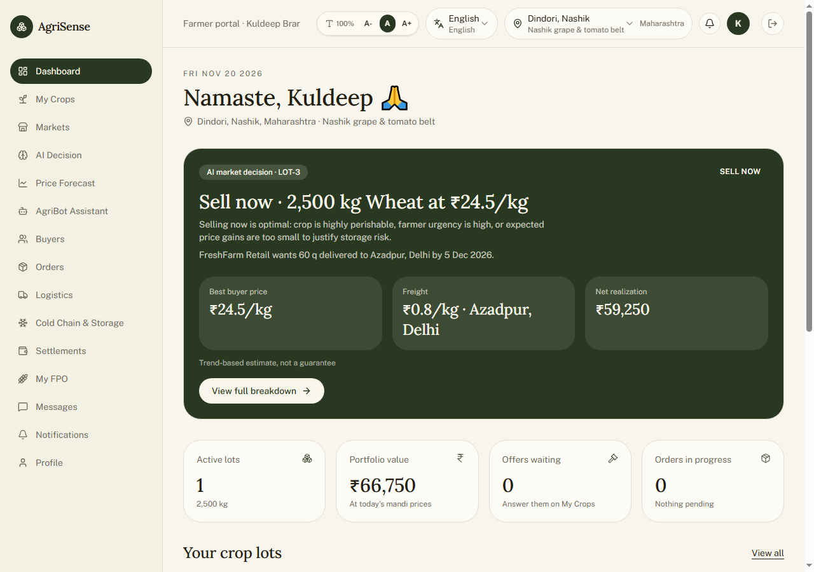
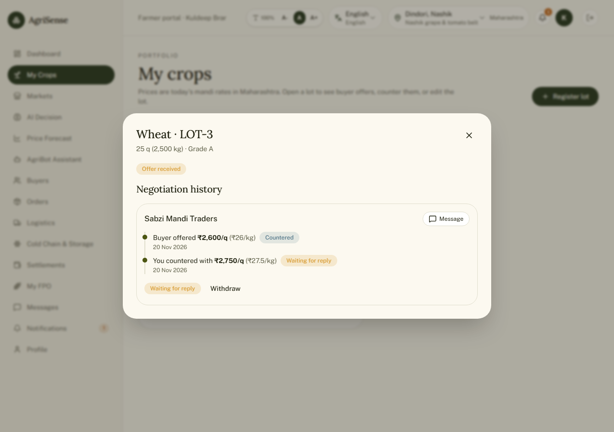
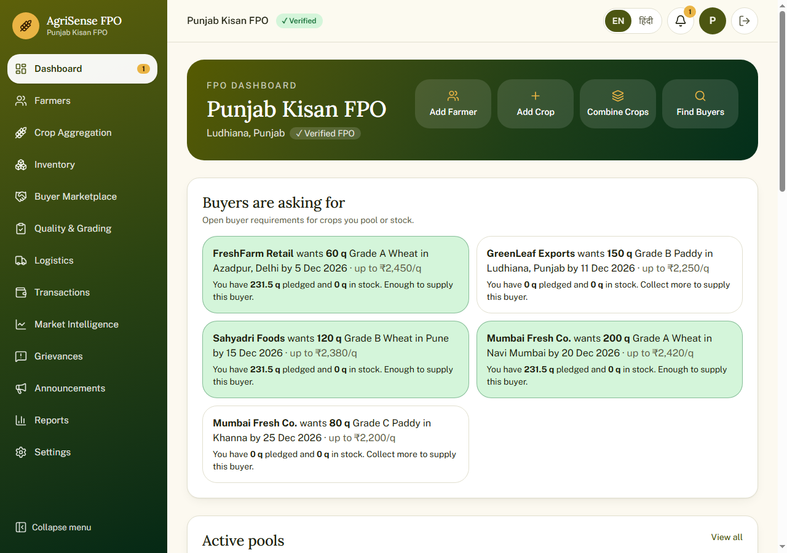
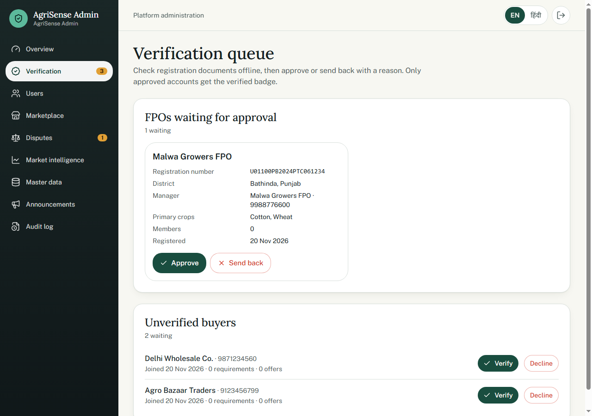

# AgriSense — Agricultural Market Intelligence

AgriSense is a Smart India Hackathon (SIH 2026) prototype that helps farmers, Farmer Producer Organisations (FPOs) and buyers trade crops on better terms. It answers one question for the farmer: **which buyer or market gives the best practical return after freight, storage, timing and crop risk?**

It brings together live mandi prices, buyer requirements, sell/hold advice, negotiation, order tracking, payments, FPO crop pooling and an admin console, all backed by one Rust API and a SQLite database.



| Negotiation history | FPO portal | Admin verification |
|---|---|---|
|  |  |  |

## The problem it solves

Small farmers usually sell at the nearest mandi on the day of harvest, without knowing what other markets or buyers pay, what freight costs, or whether prices are about to rise. Buyers struggle to find reliable suppliers in the quantities they need. AgriSense:

- shows **live mandi prices** (Mandi API) and a **trend-based price outlook**, clearly labelled as an estimate;
- **matches each lot to buyer requirements**, ranked by price, freight, buyer trust, quality and deadline;
- lets farmers and buyers **negotiate** (offer, counter, accept, decline) and then **track the order and the payment** to the end;
- lets **FPOs pool** members' crops into bulk lots, sell them, and split the money fairly by quantity and grade;
- gives the **admin** verification, dispute handling, market monitoring and an audit log.

## Portals and demo logins

The demo data loads automatically the first time the backend starts. All demo PINs are `1234` (change it with `DEMO_PIN`).

| Portal | Sign in at | Phone | What to try |
|---|---|---|---|
| Farmer | `/auth` | `9876543210` (Ramesh Kumar) | Dashboard advice, My Crops, a payment waiting for confirmation, messages |
| Buyer | `/auth` | `1234567890` (FreshFarm Retail) | Browse produce, requirements, suppliers, orders and invoices |
| FPO | `/auth` | `9988776655` (Punjab Kisan FPO) | Pools, members, sales and payouts |
| FPO members | `/auth` (farmer) | `9876500001` to `9876500006` | My FPO, pledging to a pool, payouts |
| FPO waiting for approval | `/auth` | `9988776600` (Malwa Growers FPO) | The "waiting for verification" screen |
| Admin | `/admin/login` | from `ADMIN_PHONE` / `ADMIN_PIN` | Verification, disputes, marketplace flags, audit log |

There is no default admin password. The admin account is created only when `ADMIN_PHONE` and `ADMIN_PIN` are set.

## Tech stack

| Area | Technology |
|---|---|
| Backend | Rust 2021, Axum 0.7, Tokio, SQLx 0.7 with SQLite (WAL), Argon2 PIN hashing |
| External data | [Mandi API](docs/api/MANDI-API-SPEC.md) for live and historical mandi prices (no key needed) |
| Frontend | React 19, TanStack Start / Router / Query, Vite, TypeScript, Tailwind CSS 4, Recharts |
| Languages | English, Hindi, Marathi, Punjabi, Gujarati (the newer FPO, admin and deal screens cover English, Hindi, Punjabi and Gujarati) |

## Run it locally

You need Rust (stable), Node.js 20.19 or newer with npm (or Bun), and internet access for live mandi prices.

**Quick start (both at once)**

```powershell
.\scripts\dev.ps1        # Windows
./scripts/dev.sh          # macOS / Linux
```

Each script copies `backend/.env.example` to `backend/.env` if it is missing, starts the backend (`cargo run` in `backend/`) and the frontend (`npm run dev` in `frontend/`, running `npm install` first if needed). Set `ADMIN_PHONE` and `ADMIN_PIN` in `backend/.env` to get an admin account.

**Or run them separately**

**1. Backend** (always from `backend/`, because `DATABASE_URL=sqlite:agri_prototype.db` is relative to where `cargo run` starts):

```powershell
cd backend
copy .env.example .env      # then set ADMIN_PHONE and ADMIN_PIN
$env:PORT = "3001"
cargo run
```

On macOS or Linux: `cd backend && cp .env.example .env && PORT=3001 cargo run`.

The first start creates `backend/agri_prototype.db`, applies the migrations and loads the demo data. Check it with `curl http://localhost:3001/health`.

**2. Frontend** (second terminal):

```powershell
cd frontend
npm install
npm run dev
```

Open <http://localhost:5173>. Vite forwards `/api` to the backend on port 3001. See [frontend/README.md](frontend/README.md) for more.

**Checks**

```powershell
# backend (from backend/)
cargo test
cargo clippy --all-targets
# frontend (from frontend/)
npm run lint
npm run build
```

## Demo flow (about 10 minutes)

1. **Farmer**: register a new farmer, set the farm location on Profile, then add a lot on **My Crops**. Buyers with a matching requirement are notified.
2. **Buyer**: register a buyer, post a requirement for the same crop. The matching-lot count updates; open it and offer your price. Or find the farmer on **Suppliers** or **Browse produce**.
3. **Farmer**: the offer appears in Notifications and on the lot. Open **Offers & history**, counter with a higher price.
4. **Buyer**: accept the counter offer on the dashboard. An order starts for both sides.
5. Message each other from the order or lot (**Messages**, refreshed every 10 seconds).
6. **Farmer** marks the order picked up and in transit; **buyer** marks it delivered (**Orders** or **Logistics**).
7. **Buyer** records the payment on **Payments**; **farmer** confirms it was received. The order becomes completed, and the invoice is on `/invoice/<order id>`.
8. **FPO**: sign in as the demo FPO to see pools, intake, sales and the payout split. **Admin**: approve the waiting FPO and buyer, review the open dispute, and check the audit log.

## Repository layout

```text
AgriSense/
├── README.md                # this file
├── backend/                 # Rust API (Axum + SQLx, SQLite)
│   ├── README.md            # architecture, configuration and the full API reference
│   ├── .env.example
│   ├── Cargo.toml
│   ├── migrations/          # SQLx migrations (never edit an applied one)
│   └── src/
├── frontend/                # React app (Vite + TanStack Start/Router)
│   ├── README.md
│   ├── public/
│   └── src/
├── docs/
│   ├── api/MANDI-API-SPEC.md
│   ├── database/migrations.md
│   └── screenshots/
└── scripts/
    ├── dev.ps1              # start backend + frontend (Windows)
    └── dev.sh               # start backend + frontend (macOS / Linux)
```

See [backend/README.md](backend/README.md) for the architecture, configuration and every API endpoint, and [frontend/README.md](frontend/README.md) for the frontend.

## Honest limits

- Price forecasts are a **trend-based estimate** from recent mandi prices (moving averages and a damped trend), not a trained model and not a guarantee.
- Freight comes from a small route table (state to state); unknown routes are shown as "not known" rather than guessed.
- Payments are recorded by the buyer and confirmed by the farmer; no money moves through AgriSense.
- The Mandi API covers a limited set of states (Haryana, for example, is missing), and its free hosting can be slow on the first request.
- AgriBot answers come from a fixed set of agricultural answers, not a live AI model.
